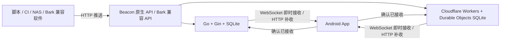

# Beacon

## 1. 这是什么

Beacon 是一个自托管的 Android 消息推送应用。手机安装 App，服务端部署在自己的服务器、NAS 或 Cloudflare Workers 上，脚本、CI 和其他软件就可以通过 HTTP API 向手机发送通知。

适合接收下载完成、任务执行结果、服务器告警等消息。支持 Beacon 原生 API 和 Bark 兼容推送接口，手机通过 WebSocket 即时接收或 HTTP 定时补收，不依赖第三方手机推送通道。

本项目包含 Android 客户端、Go 服务端和 Workers 服务端。“三端”指这三个组件；使用时安装 Android App，再任选一种服务端即可。

## 2. 主要功能

- **Android 自托管推送**：支持 WebSocket 即时接收、HTTP 定时补收，以及按电量、时间段、充电和 Wi-Fi 条件切换的规则接收。
- **两种服务端可选**：Go 单文件 / Docker 适合服务器和 NAS；Cloudflare Workers 使用 Durable Objects SQLite 保存数据。
- **Beacon 原生 API 与 Bark 兼容接口**：脚本可发送标题、副标题、Markdown 正文、优先级、分组和有效期；原生接口支持最多一个 HTTPS 操作按钮。
- **离线补收与接收确认**：消息先保存到服务端，手机恢复连接后补收有效消息；推送请求支持幂等键，避免重试产生重复消息。
- **手机内管理**：在 App 中绑定设备、管理应用令牌、发送测试消息、查看存储概况和清理数据。
- **通知与消息管理**：支持免打扰时段、过时消息提醒策略、锁屏预览、消息搜索与分组筛选、历史导入导出及设置备份。
- **MCP 接入**：本机 stdio 服务可供支持 MCP 的 AI 客户端发送任务通知，详见 [MCP 文档](mcp/README.md)。
- **实时状态与桌面小组件**：额度、下载进度、热搜列表和文字公告可以持续更新；支持多个独立小组件、四种尺寸、十种样式、内容排序及统一或单独配色，详见[小组件数据上报 API](#小组件数据上报-api)。

即时接收需要允许 Android 后台运行，连接稳定性受系统和网络影响；定时补收可能延迟。服务端接收成功表示消息已保存，接收确认表示客户端已接收，均不代表用户已经阅读。

## 3. 技术架构

结构化消息、实时状态与桌面小组件已接入；数据上报格式与 API 示例见本文[小组件数据上报指南](#小组件数据上报-api)，设计草稿与验收素材仅保留在本地。数据库升级前请备份；小米最新系统仍待真机验收。



图中两种服务端是可选方案，不需要同时部署。

| 组件 | 技术 | 职责 |
| --- | --- | --- |
| Android 客户端（`android/`） | Kotlin、Jetpack Compose、OkHttp、WorkManager、SQLite | 设备绑定、消息接收与本地保存、通知展示、服务器管理 |
| Go 服务端（`server/`） | Go、Gin、SQLite、WebSocket | 可部署为单文件程序或 Docker 容器，持久化消息和设备信息 |
| Workers 服务端（`workers/`） | TypeScript、Cloudflare Workers、Durable Objects SQLite | 托管 HTTP API、消息存储、WebSocket 连接与定时维护 |

两种服务端共用 `/api/v1/*` 和 `/api/admin/*` 协议。推送先保存到服务端，再投递给手机；断线恢复后，App 可以补收尚未过期的消息。HTTP 推送成功只表示服务端已接受并保存消息，不代表手机已经展示通知。

凭据分为管理令牌、一次性绑定码、设备推送密钥和设备接收凭据。管理令牌用于管理服务器，App 使用独立 Android Keystore 加密保存登录凭据并长期保留，退出登录或服务器拒绝凭据时清除；绑定码用于连接手机；推送密钥用于发送消息；接收凭据由 App 保存并用于同步与确认接收。

## 4. 三端获取与部署

### 4.1 Android 客户端

1. 打开 [Releases](https://github.com/ZeroHomers0/beacon/releases)，下载通用包 `beacon-release.apk`。同时提供 `beacon-release-arm64-v8a.apk`（64 位 ARM）和 `beacon-release-armeabi-v7a.apk`（32 位 ARM）；不确定设备架构时选择通用包。
2. 在 Android 8.0 及以上设备安装，首次安装时按系统提示允许对应来源安装应用。
3. 安装后按第 5 节绑定自己的服务端，并开启通知权限。

若某次构建只有 `beacon-release-unsigned.apk`，该文件需要自行签名后才能安装。自行编译可使用 `android/` 中的 Gradle 工程；正式版本签名配置见 [构建脚本](android/app/build.gradle.kts)。

Android 流水线按 v7a、v8a、通用包三个并行任务构建，分别提供校验和，使用相同的版本号和正式签名。App 内更新继续下载通用包。自行编译时默认生成通用包，也可在 `android/` 下运行 `./gradlew -PbeaconAbi=arm64-v8a :app:assembleRelease` 或 `./gradlew -PbeaconAbi=armeabi-v7a :app:assembleRelease` 生成对应架构的包。

### 4.2 Go 服务端

#### Docker / NAS 部署

从 [Releases](https://github.com/ZeroHomers0/beacon/releases) 下载 `docker-compose.yaml`，放到单独目录中。也可以使用仓库中的 [Compose 配置](server/docker-compose.yaml)。以下命令适用于 Linux 服务器：

```bash
mkdir -p beacon-data
sudo chown 65532:65532 beacon-data
sudo chmod 700 beacon-data
openssl rand -hex 32
```

将生成的随机值填入配置中的 `BEACON_WEB_ADMIN_TOKEN`，替换示例令牌。然后启动：

```bash
docker compose up -d
docker compose ps
curl http://127.0.0.1:8088/healthz
```

默认镜像为 `ghcr.io/zerohomers0/beacon-server:latest`。数据保存在当前目录的 `beacon-data/`，容器以 UID/GID `65532:65532` 运行，目录必须提前创建并允许该用户写入；NAS 可通过其权限管理界面设置。

配置自己的 HTTPS 域名，例如 `https://push.example.com`，将反向代理上游指向 `http://127.0.0.1:8088`，并开启 WebSocket 转发（保留 `Upgrade` 和 `Connection` 请求头）。Compose 默认只监听宿主机回环地址；如果反向代理运行在其他容器或其他机器，需要相应调整网络与上游地址。

#### 单文件部署

从 [Releases](https://github.com/ZeroHomers0/beacon/releases) 下载符合服务器架构的 `beacon-server-linux-amd64` 或 `beacon-server-linux-arm64`。以 amd64 为例：

```bash
chmod +x beacon-server-linux-amd64
export BEACON_WEB_ADMIN_TOKEN="$(openssl rand -hex 32)"
./beacon-server-linux-amd64 -listen 127.0.0.1:8088 -db ./beacon.db
```

妥善保存生成的管理令牌，以便在 App 中登录服务器管理。正式运行可用 systemd 等方式托管进程，并配置 HTTPS 和 WebSocket 反向代理。数据库会自动初始化。

### 4.3 Cloudflare Workers 服务端

#### 可视化快速部署

1. 将 [Beacon 仓库](https://github.com/ZeroHomers0/beacon) Fork 到自己的 GitHub 账号。
2. 打开 [Cloudflare 控制台](https://dash.cloudflare.com/)，进入 **Workers & Pages**，创建 Worker，选择通过 GitHub 仓库导入，授权并选中自己的 Fork。
3. 设置根目录为 `workers`，Worker 名称与 `workers/wrangler.toml` 中的 `name` 保持一致，默认是 `beacon-server`。
4. 构建命令填写 `npm run build`，部署命令填写 `npm run deploy`，完成部署。构建依赖来自 `workers/package.json`；若构建环境未自动安装依赖，可将构建命令改为 `npm ci && npm run build`。根目录设置说明见 [Cloudflare 构建配置](https://developers.cloudflare.com/workers/ci-cd/builds/configuration/)。
5. 在该 Worker 的 **Settings → Variables and Secrets（设置 → 变量和机密）** 中添加运行时 **Secret**：名称为 `ADMIN_TOKEN`，值为自己生成并保存的随机令牌。建议使用 `openssl rand -hex 32` 生成的 64 位十六进制字符串。保存并部署使其生效。
6. 访问 `https://你的Worker域名/healthz`，确认返回 `status: ok`，再用该 HTTPS 服务地址在 App 中绑定。

`ADMIN_TOKEN` 必须是运行时机密，放在 Build variables 中无法供服务端使用。未配置或长度不足 32 字符时，服务端返回 `503 server_not_configured`。

本项目通过 [wrangler.toml](workers/wrangler.toml) 声明 `BEACON` Durable Objects 绑定和 SQLite 存储类，首次访问时自动初始化数据库，无需手工创建 D1、KV、R2 或上传 SQL。保留默认 `BEACON_INSTANCE=default`；修改它会指向另一个数据实例，因此绑定设备后应保持不变。

如果默认 `workers.dev` 域名在你的网络中无法访问，可在 Worker 的域名设置中添加自定义域名。SQLite Durable Objects 可用于 Workers 免费计划，具体额度和收费以 [Cloudflare 官方说明](https://developers.cloudflare.com/durable-objects/platform/pricing/) 为准。

#### CLI 部署

本机准备好 Git、Node.js 和 npm 后执行：

```bash
git clone https://github.com/ZeroHomers0/beacon.git
cd beacon/workers
npm ci
npx wrangler login
npm run check
npm run deploy
npx wrangler secret put ADMIN_TOKEN
```

最后一步按提示输入自己生成的管理令牌。部署完成后用 `/healthz` 检查服务，并保存服务地址与管理令牌。

## 5. 简单教程

### 绑定手机并发送第一条消息

1. 部署任意一种服务端，确认手机能够访问其 HTTPS 地址。
2. 打开 App 的「服务器管理」，输入服务地址和部署时设置的管理令牌。
3. 创建设备绑定码。管理接口生成的绑定码 **10 分钟内有效，仅可使用一次**。
4. 在「服务器配置」填写同一个服务地址、设备名称和绑定码，完成绑定；管理页面也提供绑定当前手机的操作。
5. 开启通知权限，在「接收模式」中选择「即时接收」。按系统提示允许后台运行，并调整电池优化设置。
6. 在连接设置中点击「复制推送密钥」，执行下面的推送命令，确认 App 中出现消息和系统通知。

```bash
curl -X POST 'https://push.example.com/api/v1/push' \
  -H 'Authorization: Bearer YOUR_PUSH_KEY' \
  -H 'Content-Type: application/json' \
  -d '{"title":"你好，Beacon","body":"第一条推送消息","priority":5}'
```

将 `https://push.example.com` 替换为自己的服务地址，`YOUR_PUSH_KEY` 替换为设备推送密钥。App 的连接设置也提供可直接复制的推送示例。

### 接收方式与省电设置

| 模式 | 行为 | 适用情况 |
| --- | --- | --- |
| 即时接收 | 保持 WebSocket 连接，断线重连后补收 | 需要及时接收通知 |
| 省电接收 | 使用 HTTP 周期补收，执行时间由 Android 后台调度决定 | 可以接受延迟；也是初始默认模式 |
| 规则接收 | 根据电量、时间段、充电或 Wi-Fi 条件切换 | 希望按使用环境调整接收方式 |

自适应心跳默认开启，使用 60、90、120、180、240、300 秒档位，每档连续确认 3 次后才继续上探；已有网络记录会先以 60 秒验证，再尝试记忆间隔。心跳超时后回退到较短的安全档位，并按网络记忆失败间隔，30 分钟内不再尝试该间隔及更长间隔。关闭后使用所选固定间隔。反向代理应允许至少 450 秒的 WebSocket 空闲连接。

「普通消息批量接收」默认关闭。开启后，优先级 0–7 的新消息等待下一次心跳集中投递，8–10 仍立即投递，每批最多 100 条。手动同步和重连补收可直接拉取消息；批量接收会增加普通消息的等待时间。

客户端会合并接收回执、减少正常连接下的重复 HTTP 补收，并在限流或服务故障时按 `Retry-After` 等待重试。未获电池优化豁免的设备进入系统休眠时会暂停长连接，退出休眠后恢复并补收；休眠期间的后台任务不保证即时执行。

### 通知、历史与应用令牌

- **通知设置**：按优先级选择通知渠道，可设置免打扰时段、过时消息静默或仅保存，以及锁屏内容预览。最终提醒效果受 Android 通知渠道与系统设置影响。
- **消息详情**：支持 Markdown 渲染、查看原文、复制与分享；正文图片默认不下载，提供点击加载入口。HTTPS 操作按钮由用户点击后打开。
- **搜索与筛选**：可按已读状态、分组或应用筛选，也可搜索标题、正文、分组、应用名称和 ID；支持 `group:CI`、`app:完整应用ID`。
- **存储与备份**：手机本地历史支持清理、导入导出，设置可单独备份；服务端历史保留时间独立配置。
- **应用令牌**：在「服务器管理」中为脚本创建独立令牌并设置默认优先级。令牌只在创建时显示一次，发送时使用 `Authorization: Bearer <应用令牌>`；复制的推送地址不含令牌。令牌可单独撤销；撤销后可删除应用及其消息和投递队列。

### MCP 接入

仓库的 `mcp/` 提供本机 stdio 服务，需要 Node.js 18 或以上。将 MCP 客户端的启动命令配置为 `node /绝对路径/beacon/mcp/beacon.mjs`，并传入 `BEACON_BASE_URL` 和 `BEACON_PUSH_KEY` 即可发送通知，无需单独部署网络服务。

工具包括 `push_notification`（推送）、`beacon_status`（只读能力查询）和 `beacon_apps`（只读管理概况）；后两项分别需要额外的设备接收凭据与管理令牌。完整配置、参数与验证方式见 [MCP README](mcp/README.md)。

### 定时任务示例

[examples/qinglong](examples/qinglong/README.md) 提供一个青龙面板脚本：定时拉取「60s API」的每日新闻，整理成 Markdown 推送到本服务。脚本只用 Python 标准库，按日期去重，并附带 `Idempotency-Key`，可直接照着改成其他数据源的定时推送。

## 6. 支持的 API

Go 和 Cloudflare Workers 两种服务端均支持以下接口。先在 App 中绑定服务器，再在连接设置中点击「复制推送密钥」。下面示例中的 `https://push.example.com` 替换为自己的服务地址，`YOUR_PUSH_KEY` 替换为设备推送密钥。推送密钥允许向对应设备发送消息，请勿公开；绑定码和管理令牌不能代替它。App 的连接设置也提供可直接复制的推送示例。

### Beacon 原生接口

向 `POST /api/v1/push` 发送 JSON，通过 `Authorization: Bearer <密钥>` 认证：

```bash
curl -X POST 'https://push.example.com/api/v1/push' \
  -H 'Authorization: Bearer YOUR_PUSH_KEY' \
  -H 'Content-Type: application/json' \
  -d '{"title":"下载完成","subtitle":"NAS","body":"文件已下载","priority":5}'
```

| 字段 | 说明 |
| --- | --- |
| `body` | 必填，非空正文，最多 65536 UTF-8 字节 |
| `title` | 可选，标题，最多 1024 UTF-8 字节 |
| `subtitle` | 可选，副标题，最多 1024 UTF-8 字节 |
| `priority` | 可选，0–10 的整数；设备推送密钥默认使用 5 |
| `actions` | 可选，最多 1 个操作按钮，格式为 `[{"title":"查看日志","url":"https://example.com/logs"}]`；省略或空数组表示没有按钮 |
| `group` | 可选，消息分组，最多 128 UTF-8 字节 |
| `ttl` | 可选，消息投递有效期，单位秒，0–604800 的整数；省略或 0 使用七天默认值 |

优先级 0–1 仅保存消息，2–3 静默通知，4–7 普通通知，8–10 重要通知。原生接口也接受服务端管理中创建的应用推送令牌；省略 `priority` 时使用该应用的默认优先级。

成功返回 HTTP 200，响应包含消息的 `id`、`sequence`、`expires_at_ms` 等信息。使用应用令牌发送时还包含 `application_id` 与 `application_name`；它们由服务器生成，不能由发送方指定。

正文可直接发送 Markdown，无需额外格式字段，原生 API 与 Bark 接口均适用。Android 客户端在详情页渲染标题、加粗、斜体、列表、引用、链接和代码块，并提供「查看原文」切换；通知与消息列表显示去除排版标记的短摘要。复制、分享和搜索仍使用原始正文。Markdown 中前五个不同的有效 HTTPS 图片地址提供点击加载入口，默认不下载图片；网页链接点击后确认打开。HTML 只显示为文本，暂不支持表格、公式等扩展语法。正文上限为 65536 UTF-8 字节。

#### 带操作按钮的消息

每个操作必须包含 `title` 和 `url`，不接受其他字段。`title` 不能全为空白或包含控制字符，输入最多 64 UTF-8 字节，展示文案最多四个字符，超出自动截断；`url` 最多 2048 UTF-8 字节，必须为有效 HTTPS 地址，不能包含用户名或密码。`actions: null`、超过 1 个按钮或无效字段返回 `400 invalid_message`。

```bash
curl -X POST 'https://push.example.com/api/v1/push' \
  -H 'Authorization: Bearer YOUR_PUSH_KEY' \
  -H 'Content-Type: application/json' \
  -d '{"title":"构建失败","body":"主分支构建失败，请查看日志","group":"CI","actions":[{"title":"查看日志","url":"https://ci.example.com/builds/123"}]}'
```

App 在消息详情展示按钮和目标地址，点击后交给系统浏览器或对应应用打开。收到消息不会自动打开链接，也不会代用户发起带鉴权的请求。按钮随历史消息和备份保存，HTTP 补收与即时接收均支持；幂等判断包含按钮标题、地址和排列顺序。

Bark 的 `url` 在详情页显示为“打开链接”按钮，Bark 接口不支持 `actions` 数组。

需要自动重试的脚本可添加 `Idempotency-Key` 请求头（1–128 个不含空格的可见 ASCII 字符）。同一发送凭据下，相同键与相同内容在首次成功后七天内返回原消息，不重复保存或创建投递任务；同键不同内容返回 `409 idempotency_conflict`。消息已确认、已过期或历史已清理时仍返回原结果，不重新投递。换用不同凭据、超过七天或不带幂等键时会创建新消息。每个业务事件使用一个新键，失败重试时保持键和内容一致。

```bash
curl -X POST 'https://push.example.com/api/v1/push' \
  -H 'Authorization: Bearer YOUR_PUSH_KEY' \
  -H 'Idempotency-Key: build-20261012-001' \
  -H 'Content-Type: application/json' \
  -d '{"title":"构建完成","body":"构建已通过","group":"CI","ttl":3600}'
```

有效期按服务端时间计算。到期后 HTTP 补收和 WebSocket 均停止投递，后台维护随后清理过期正文；已保存到手机的历史不会随有效期到期而消失。手机消息卡片显示分组与应用名称，点击标签可精确筛选，也可在搜索栏输入 `group:CI` 或 `app:完整应用ID`。普通搜索同时匹配正文、标题、分组、应用名称和应用 ID。

服务端接收成功表示消息已保存，不代表手机已经收到或展示通知。

### Bark 兼容接口

支持自定义服务器地址的 Bark 第三方软件，可以直接通过 Beacon 服务推送到自己的 App。如果软件要求填写完整的 Bark 推送链接，填：

```text
https://push.example.com/YOUR_PUSH_KEY
```

如果软件分别要求服务器地址和 Device Key，则分别填写 `https://push.example.com` 和设备推送密钥。Bark 接口使用设备推送密钥，应用推送令牌请使用上面的原生接口。只支持固定 Bark 官方地址、无法修改服务器的软件不能通过此方式接入。

支持以下 GET 路径，消息内容作为路径片段时需要 URL 编码，尤其是 `/`、`?`、`#` 等字符：

```text
GET /<密钥>/<正文>
GET /<密钥>/<标题>/<正文>
GET /<密钥>/<标题>/<副标题>/<正文>
```

也可以通过查询参数发送，使用 `curl --data-urlencode` 自动编码中文和特殊字符：

```bash
curl --get 'https://push.example.com/YOUR_PUSH_KEY' \
  --data-urlencode 'title=下载完成' \
  --data-urlencode 'body=文件已下载到 NAS'
```

支持 `POST /push`，请求体可以是 JSON 或 `application/x-www-form-urlencoded` 表单，用 `device_key` 指定设备：

```bash
curl -X POST 'https://push.example.com/push' \
  -H 'Content-Type: application/json' \
  -d '{"device_key":"YOUR_PUSH_KEY","title":"下载完成","body":"文件已下载到 NAS"}'
```

也支持向 `POST /<密钥>` 发送同样的 JSON 或表单，此时无需填写 `device_key`。参数优先级为路径 > 查询参数 > 请求体。成功响应示例：

```json
{"code":200,"message":"success","timestamp":1791763200,"id":"消息 ID","sequence":1}
```

兼容范围：

- 支持 `title`、`subtitle`、`body`，文本长度限制与原生接口一致。
- `level=passive` 或 `sound=none` 对应优先级 2；`level=timeSensitive`、`level=critical` 对应优先级 8；其余默认使用 5。Android 通知效果仍受系统通知权限和通知渠道设置影响。
- 接收 `image`、`icon`、`url`、`sound` 扩展字段；链接字段仅保留有效的 HTTPS 地址。Bark 的 iOS 铃声和 critical alert 权限不等同于 Android 上的效果。
- 接收 `ciphertext`、`iv` 加密字段。在 Android「设置 → 服务器配置 → Bark 消息解密」配置与发送方一致的 AES 加密密钥和默认 IV；先完成服务器绑定。AES-CBC 密钥需为16、24或32个 UTF-8 字节，默认 IV 为16字节，均按原始文本输入，不是十六进制/Base64解码输入。消息自带 IV 时优先使用消息中的值。
- 密钥仅通过 Android Keystore 加密保存在手机，不上传服务端、不回显；服务器只转发密文。保存配置后自动尝试解密尚未解密的历史消息。可替换密钥，或通过「移除解密配置」停止后续自动解密；移除保留服务器绑定和已解密的历史正文。重新绑定服务器或清除本机配置后需重新配置解密密钥。
- 支持 `group` 与 `ttl`；Beacon 的 `ttl` 单位为秒，范围与原生接口一致，JSON 可使用整数或整数字符串，表单/查询参数使用整数字符串。
- Bark 接口也支持 `Idempotency-Key` 请求头，作用域、有效窗口与原生接口相同。
- `badge`、`action` 等未实现参数会被忽略，不影响正常文本推送。

### 常见错误

| HTTP 状态 | 含义 |
| --- | --- |
| `400` | 消息或参数格式不正确，例如正文为空、文本超长 |
| `401` | 推送密钥无效或已撤销 |
| `413` | 请求过大 |
| `415` | Bark POST 请求的 Content-Type 不受支持，请使用 JSON 或表单 |
| `409` | 幂等键已用于不同内容，请为新事件使用新键 |
| `429` | 推送频率超过限制，稍后重试 |
| `507` | 服务端存储容量达到限制 |


### 客户端与管理接口

以下接口在两种服务端中均支持。除绑定和健康检查外，认证均使用 `Authorization: Bearer <对应凭据>`；推送密钥不能代替接收凭据或管理令牌。

| 方法 | 路径 | 认证 | 用途 |
| --- | --- | --- | --- |
| GET | `/healthz` | 无 | 健康检查 |
| POST | `/api/v1/bind` | 一次性绑定码（请求体） | 绑定设备，字段为 `binding_code`、`device_name` |
| GET | `/api/v1/capabilities` | 设备接收凭据 | 查询服务端能力与协议 |
| GET | `/api/v1/realtime/config` | 设备接收凭据 | 获取即时连接配置 |
| GET / WebSocket Upgrade | `/api/v1/realtime/stream` | 设备接收凭据 | 建立即时接收连接 |
| GET | `/api/v1/messages` | 设备接收凭据 | 分页获取消息，支持 `after`、`limit`、`pending=1` |
| POST | `/api/v1/messages/ack` | 设备接收凭据 | 确认接收，请求体为 `{"ids":["消息 ID"]}` |
| POST | `/api/v1/receipts/status` | 设备接收凭据 | 查询消息回执，请求体为 `{"ids":["消息 ID"]}` |
| POST | `/api/v1/device/revoke` | 设备接收凭据 | 撤销当前设备 |
| GET | `/api/admin/overview` | 管理令牌 | 查询设备、应用和存储概况 |
| GET | `/api/admin/metrics` | 管理令牌 | 按路由模板聚合的请求量、5xx 数与延迟分桶（用于排查慢接口，不含路径参数与凭证） |
| POST | `/api/admin/binding` | 管理令牌 | 创建绑定码，字段为 `name` |
| POST | `/api/admin/test` | 管理令牌 | 向设备发送测试消息，字段为 `device_id`、`title`、`subtitle`、`body`、`priority` |
| POST | `/api/admin/revoke` | 管理令牌 | 撤销设备，字段为 `device_id` |
| POST | `/api/admin/devices/delete` | 管理令牌 | 删除设备及关联数据，字段为 `device_id` |
| POST | `/api/admin/messages/clear` | 管理令牌 | 清空服务端消息，请求体为 `{}` |
| POST | `/api/admin/applications` | 管理令牌 | 创建应用令牌，字段为 `device_id`、`name`、`default_priority` |
| POST | `/api/admin/applications/revoke` | 管理令牌 | 撤销应用令牌，字段为 `id` |
| POST | `/api/admin/applications/delete` | 管理令牌 | 删除已撤销的应用令牌及其消息，字段为 `id` |

例如，不通过 App 管理页面也可以创建绑定码：

```bash
curl -X POST 'https://push.example.com/api/admin/binding' \
  -H 'Authorization: Bearer YOUR_ADMIN_TOKEN' \
  -H 'Content-Type: application/json' \
  -d '{"name":"我的手机"}'
```

Go 服务端需要设置 `BEACON_WEB_ADMIN_TOKEN` 才会启用管理接口，要求为 64 位十六进制字符串，也可通过 `BEACON_WEB_ADMIN_TOKEN_FILE` 从文件读取；Workers 必须设置至少 32 字符的 `ADMIN_TOKEN` 才能正常提供服务。

## 7. 常见问题

### 必须同时部署 Go 和 Workers 吗？

任选一个即可。已有服务器或 NAS 可以使用 Go / Docker；希望托管在 Cloudflare 上可以使用 Workers。更换服务端需要在 App 中重新绑定，两种后端的数据独立保存。

### 打开服务地址为什么没有网页？

当前服务端提供 API，没有浏览器管理首页。请访问 `/healthz` 检查服务，在 Android App 的「服务器管理」中管理设备和应用。

### Workers 返回 `server_not_configured` 怎么办？

检查当前 Worker 是否配置了运行时 Secret `ADMIN_TOKEN`，长度至少 32 字符，并已部署生效。Build variables 不属于运行时机密。也需保留 `BEACON_INSTANCE` 配置。

### Cloudflare 看不到 Fork 仓库怎么办？

检查 Cloudflare 的 GitHub 应用是否获准访问该仓库，重新授权或刷新仓库列表，并确认所选 GitHub 账号正确。构建找不到 `package.json` 或 `wrangler.toml` 时，检查根目录是否设为 `workers`。

### API 返回成功，手机为什么没通知？

先查看 App 中是否已经出现消息。有消息但无通知时，检查通知权限、通知渠道、免打扰和消息优先级；没有消息时，检查服务器连接、接收模式、规则条件和后台运行权限。即时接收还需要反向代理正确转发 WebSocket。省电模式可能被 Android 延后执行，可以手动同步检查。

### 管理令牌、绑定码和推送密钥有什么区别？

管理令牌可以管理整个实例；绑定码仅用于一次设备绑定；推送密钥仅用于向对应设备发送消息。它们不能互换。应用推送令牌使用 Beacon 原生接口，Bark 接口使用设备推送密钥。

### Bark 软件能直接接入吗？

可以，前提是软件允许修改 Bark 服务器地址或填写完整推送链接。填写自己的服务地址与设备推送密钥，消息由 Beacon Android App 接收。兼容参数范围见第 6 节。

### 消息保存多久？

未确认接收的消息投递窗口为 7 天，回执窗口为 30 天。已确认消息的服务端历史默认保留 1 天，可用 Go 的 `BEACON_HISTORY_RETENTION_DAYS` 或 Workers 的 `HISTORY_RETENTION_DAYS` 调整，实际范围为 1–30 天，`0` 按 1 天处理。手机本地消息由 App 的存储与清理设置管理。

Go 服务端在写入前校验 UTF-8 和消息字节长度，超限拒绝，不截断正文。单设备待收消息最多 10000 条、64 MB，全局消息最多 100000 条、有效数据库页预算 256 MB；满额时拒绝新推送，不删除仍在有效期内的待收消息。SQLite 主文件另设 512 MB 页数上限（已有更大文件不会自动缩小），删除后的空闲页复用；WAL 每 256 页自动检查点，检查点完成后的日志保留目标为 4 MB，该值不是活跃事务期间的硬上限。不要长期持有外部 SQLite 读事务，以免妨碍检查点回收。

绑定码最多保留 1000 条，过期绑定码随每分钟的分批维护自动删除。Compose 使用 Docker `local` 日志驱动，单文件 10 MB、最多 3 个文件；更新现有部署需重新创建容器以应用日志配置。直接运行二进制时由 systemd/journald 或外部日志轮转工具限制标准输出日志；反向代理日志也需独立设置轮转，且不得记录带凭证的 Bark URL。Workers 的存储与日志由 Cloudflare 管理，不适用 Docker/SQLite 文件配置。

Go、Workers 与 Android 的消息字段限制一致：标题和副标题各 1024 UTF-8 字节，非空正文 65536 字节，名称和分组各 128 字节，Bark 元数据 100000 字节，自定义按钮最多 1 个（按钮标题输入上限 64 字节、显示前 4 个字符，HTTPS URL 上限 2048 字节）。非法 Unicode 拒绝接收，HTTP 与 WebSocket 消息及历史导入共用客户端字段校验。管理端发送前检查名称、标题、正文和 512 KB 请求上限；服务端仍独立验证，不依赖客户端可信。

Go 与 Workers 均限制设备最多 1024 个、应用最多 4096 个，包含已撤销但尚未删除的记录。Workers 正常维护间隔为 1 分钟，每张过期表每批最多 100 条，有积压时 1 秒后继续，覆盖消息、回执、幂等记录、绑定码和限流记录。Android 保留现有有界同步分页、32 MB 加密历史导入、2 MB 单图片下载及 6 MB/12 张图片缓存限制；手机本地历史按用户清理规则保留，不照搬服务端保留时间自动删除。

### 可以使用 HTTP 地址吗？

正式版 App 使用 HTTPS 服务地址。仅部署 Go HTTP 监听端口还不够，需要在前面配置 HTTPS 反向代理；Workers 可使用部署后提供的 HTTPS 地址。

### 推送密钥泄露或遇到其他问题怎么办？

撤销受影响的设备并创建新绑定码，在 App 中重新绑定；也可单独撤销泄露的应用令牌，再更新脚本中的密钥。反馈问题请到 [GitHub Issues](https://github.com/ZeroHomers0/beacon/issues)，附上版本、部署方式、复现步骤和错误提示。不要公开管理令牌、绑定码、推送密钥或私人消息内容；反向代理访问日志也应避免记录带密钥和正文的 Bark URL。

## 开源许可与第三方致谢

Beacon 项目本身以 [MIT License](LICENSE) 发布。

第三方组件及图标的许可说明统一在此查阅，App 的“使用与部署文档”入口可打开本 README。

| 组件或资源 | 版权归属 | 许可 |
| --- | --- | --- |
| OkHttp、Okio | Square, Inc. | Apache-2.0 |
| Material Symbols Rounded | Google LLC | Apache-2.0 |
| MIUIX | compose-miuix-ui contributors | Apache-2.0 |
| Markwon core | Markwon contributors | Apache-2.0 |
| commonmark-java | Atlassian Pty Ltd | BSD-2-Clause |

完整归属信息见 [第三方 NOTICE](android/app/src/main/assets/third-party/NOTICE.txt)，许可全文见 [Apache-2.0](android/app/src/main/assets/third-party/Apache-2.0.txt) 和 [BSD-2-Clause](android/app/src/main/assets/third-party/commonmark-BSD-2-Clause.txt)。这些声明与许可文件仍随 APK 分发。上述第三方许可与 [MIT License](LICENSE)（Beacon 项目自身）互相独立，各覆盖各自的部分。

## 实时状态与小组件

普通消息用于记录一次事件；`mode: "state"` 用于覆盖同一主题的最新数据。采集、凭据和定时任务放在外部脚本中；Beacon 负责接收、存储、同步与展示，不内置特定服务的查询逻辑。

### 主题、应用与设备

主题属于设备。应用只是可选的来源范围：绑定设备后，直接使用设备推送密钥就能上报未关联应用的主题，不必创建应用。使用应用令牌时，主题归入该应用来源。主题身份由 **设备 + 来源 + topic_key** 共同确定，不同来源可使用相同的 `topic_key`。主题在首次有效上报时自动出现。

手机「设置 → 服务器管理 → 数据主题」可按设备、来源、状态和关键词筛选，查看最新数据并清空当前状态。清空会同步到手机，保留版本水位，不能代替停止外部采集。持续主题被清空后，更高版本的上报仍可重新显示；任务类型沿用终态与删除限制。

### 添加与编辑

- 请长按桌面空白处，从小组件列表选择 Beacon 的 2×2、3×2、4×2 或 4×4；按桌面配置流程选择主题、内容和样式。App 内已移除添加入口，仅管理已有小组件。
- 新组件统一从系统桌面添加，App 内不提供复制组件功能。每个实例独立绑定主题、顺序、颜色、字号和样式，可同时展示不同进度。
- 单击桌面小组件不会进入编辑。修改设置请在桌面长按后选择编辑，或从 App 的小组件管理进入。
- 编辑已有组件时按桌面返回的实际 dp 尺寸等比预览；尚未添加时使用规格默认尺寸。系统网格、屏幕密度和桌面设置决定最终占用，格数并非固定像素。
- 不支持当前数据或空间不足的样式置灰，展示原因。数据以后发生变化而不再兼容时显示提示，保留原绑定配置。

| 样式 | 数据与显示规则 |
| --- | --- |
| 纯数字、横向进度条 | 通常1–4项；4×4纯数字最多8项、横向进度最多6项 |
| 纵向柱状图 | 2–6 个单位和范围一致的数值；窄卡限制数量 |
| 单环 | 1 个有明确范围的数值 |
| 嵌套环 | 2–3 个有明确范围的数值；4×2、4×4 显示右侧数值，2×2、3×2 仅显示圆环和中心短标题 |
| 独立小环 | 2–4 个有明确范围的数值 |
| 占比圆环 | 1 个 `segments` 数据块，最多 6 个组成部分 |
| 文字列表 | 1 个 `list` 数据块，最多 12 条；2×2、3×2 一列，4×2、4×4 两列，先从上到下再到右列 |
| 整段文字 | 使用主题 `body`，保留换行，自动换行，超长省略 |
| 迷你趋势图 | 一组`sparkline`数据，按采样时间绘制，最多120个点 |

「显示内容」可以勾选和排序；首项上移、末项下移不可点击，箭头与勾选区域互不干扰。颜色提供自动及蓝、紫、绿、橙、红、青、粉预设，可统一应用，也可单独设置某项。文字列表与整段文字提供 12/14/16/18/20/24 字号。超出空间的内容会省略，完整内容在 App 中查看。

「自选颜色」按颜色设置展示；「按状态变色」在未手动指定颜色时按发送方 `tone` 展示。「分段提示颜色」使用发送方 `bands`，需要发送方提供范围数据。背景可随手机主题，也可选择浅色、深色或透明。

### 小组件数据上报 API

小组件没有单独的上传地址。发送方把**数据主题的完整最新内容**提交到 `POST /api/v1/push`，手机收到后，再在小组件设置中选择展示内容与模板。仅发送普通通知不会自动生成小组件数据。

接入顺序：绑定设备 → 获取设备推送密钥（或创建应用并获取应用令牌）→ 上报数据主题 → 手机同步 → 长按桌面添加 Beacon 小组件 → 选择该主题和模板。详见[字段说明](#上报字段)、[各类数据格式](#数据块格式与模板对应关系)、[更新与删除](#更新版本任务与删除)、[接口及错误](#同步管理与错误处理)。

#### 可直接运行的 curl 示例

以下使用 Bash / Linux / macOS；Windows PowerShell 请使用 `curl.exe`，把同样的 JSON 保存为 UTF-8 文件，再通过 `--data-binary @payload.json` 提交。

```bash
export BEACON_URL='https://push.example.com'
export BEACON_PUSH_KEY='替换为设备推送密钥或应用令牌'

# 先确认已部署的服务端支持数据主题协议。
curl --fail-with-body "$BEACON_URL/api/v1/push-capabilities" \
  -H "Authorization: Bearer $BEACON_PUSH_KEY"

# 第一次使用 widget/demo-progress 时 revision=1；再次运行需提高版本。
# 当前采样时间用于计算“数据陈旧”，必须随每次新数据一起更新。
OBSERVED_AT_MS="$(($(date +%s) * 1000))"
curl --fail-with-body -X POST "$BEACON_URL/api/v1/push" \
  -H "Authorization: Bearer $BEACON_PUSH_KEY" \
  -H 'Content-Type: application/json' \
  --data-binary @- <<JSON
{
  "mode": "state",
  "schema_version": 1,
  "topic_key": "widget/demo-progress",
  "revision": 1,
  "observed_at_ms": $OBSERVED_AT_MS,
  "fresh_for_seconds": 600,
  "ttl": 86400,
  "title": "账户额度",
  "body": "短周期剩余24%，长周期剩余62%",
  "blocks": [
    {"kind":"progress","id":"short","label":"短周期剩余","value":24,"max":100,"unit":"%","tone":"critical"},
    {"kind":"progress","id":"long","label":"长周期剩余","value":62,"max":100,"unit":"%","tone":"normal"}
  ]
}
JSON
```

PowerShell 发送 UTF-8 `payload.json` 文件：

```powershell
$env:BEACON_URL = 'https://push.example.com'
$env:BEACON_PUSH_KEY = '替换为设备推送密钥或应用令牌'
curl.exe --fail-with-body -X POST "$env:BEACON_URL/api/v1/push" -H "Authorization: Bearer $env:BEACON_PUSH_KEY" -H 'Content-Type: application/json' --data-binary '@payload.json'
```

成功返回 HTTP 200，JSON 包含提交的内容和服务端生成的 `application_id`、`application_name`、`accepted_at_ms`、`expires_at_ms`、`stale_at_ms`、`deleted`、`unchanged`。这表示数据已接受，不代表桌面已经刷新；数据主题响应不含普通消息的 `id/sequence`。

设备推送密钥上报的数据归入“未关联应用”；应用令牌上报的数据归入该应用。归属由凭据确定，不能在请求 JSON 中填写 `device_id` 或 `application_id` 改变它。接收凭据和管理令牌不能用于上报。

#### 上报字段

除删除请求外，字段如下。所有 `*_at_ms` 均为 Unix **毫秒**时间戳，`ttl` 和 `fresh_for_seconds` 使用**秒**。

| 字段 | 必填 | 类型与含义 |
| --- | --- | --- |
| `mode` | 是 | 固定为 `"state"`；省略会走普通消息流程 |
| `schema_version` | 是 | 整数，当前固定为 `1` |
| `topic_key` | 是 | 同一来源内稳定的主题标识，UTF-8 1–128 字节，不含控制字符；例如 `nas/disk` |
| `revision` | 是 | 1–9007199254740991 的整数；每次内容更新必须递增 |
| `body` | 是 | 非空摘要或整段文字，最多 65536 UTF-8 字节；普通展示及降级使用 |
| `title` / `subtitle` | 否 | 标题 / 副标题，各最多 1024 UTF-8 字节；桌面会按尺寸截断 |
| `blocks` | 否 | 数据块数组，最多 16 块、序列化后最多 32 KiB；整段文字模板可省略 |
| `operation` | 否 | 省略或 `"upsert"` 表示完整覆盖；`"delete"` 使用下文的精简格式 |
| `state_type` | 否 | 省略或 `"persistent"` 表示持续主题；`"task"` 表示有终态的任务 |
| `status` | 任务必填 | 任务使用 `running/paused/completed/failed/cancelled`；持续主题省略 |
| `observed_at_ms` | 否 | 采样时间，非负整数，不得超前服务端时间超过 5 分钟；设置新鲜度时请同时传入实际采样时间 |
| `fresh_for_seconds` | 否 | 0 表示不启用陈旧提示；正数不得超过有效 TTL。陈旧时间为 `observed_at_ms + fresh_for_seconds × 1000` |
| `ttl` | 否 | 0 或省略为 604800 秒（7 天），最大 604800；从服务端接受时间计算，到期后同步移除数据 |
| `priority` | 否 | 0–10，沿用通知优先级；不会提高桌面刷新频率 |
| `group` | 否 | 消息分组，最多 128 UTF-8 字节 |
| `actions` | 否 | 沿用普通消息格式，最多一个 `{"title":"查看","url":"https://example.com"}` HTTPS 操作；不是小组件模板参数 |

每次上报是**完整快照，不是局部补丁**：没有再次提交的块会消失。`blocks[].id` 在同一主题内保持稳定，小组件据此保存选择与顺序；删除或改名后需重新选择。模板、字体、颜色及实例绑定在手机端配置，不要向上报 JSON 加入 `template`、`color` 等未支持字段。协议不接受早期设想中的 `data.type`、`fallback_text` 或 `collapse_key`；降级文案请用 `body`。

#### 数据块格式与模板对应关系

块通用字段：`kind` 为类型、`id` 为块内唯一标识（1–64 UTF-8 字节）、`label` 为显示名称（最多 128 字节）、`unit` 为单位（最多 32 字节）、`tone` 为 `normal/warning/critical`。未指定 `tone` 时由客户端采用默认配色，手动配色优先。数值必须有限且绝对值不超过 10^15。

| 数据块 | 必需或关键字段 | 当前桌面模板 |
| --- | --- | --- |
| `progress` | `value`、`max`；`min` 默认 0，须满足 `min ≤ value ≤ max` 且 `max > min` | 横条、柱图、单环、嵌套环、独立小环、纯数字 |
| 不确定进度 | `kind:"progress", indeterminate:true`，不要同时传 `value/min/max/trend` | 横向进度条或纯数字；需要百分比的环形不可选 |
| `metric` | `value`；`min/max` 若提供必须成对；`trend` 可为 `up/down/flat` | 无范围可用纯数字/横条；有范围可用环形/柱图 |
| `list` | `items` 1–12 项，每项有唯一 `id` 和非空 `text`，可带 `label/tone` | 文字列表：2×宽单列、4×宽双列，3×宽按可用空间展示 |
| `segments` | 正数 `total`，`items` 1–6 项；每项 `id/label/value`，值非负且总和不超过 `total` | 占比圆环；未占满部分作为剩余空间 |
| `sparkline` | `points` 1–120 项，每项 `at_ms/value`，时间非负且严格递增 | 迷你趋势图 |
| `kv` | `items` 1–12 项，每项 `id/label/text` | App 详情渲染，不直接作为桌面数值块 |
| `countdown` | `target_at_ms` 非负毫秒时间戳 | App 详情渲染，当前没有独立倒计时桌面模板 |
| `timeline` | `items` 1–12 项：`id/label/at_ms/status`；状态为 `pending/active/completed/failed` | App 详情渲染 |
| `pipeline` | `items` 1–12 项：`id/label/status`；状态为 `pending/running/completed/failed/skipped` | App 详情渲染 |
| `alert` | 非空 `text`（最多 2048 UTF-8 字节），可带 `tone` | App 详情渲染 |
| 整段文字 | 主题顶层 `body`，不需要新增块类型 | 整段文字 |

文字列表的 `items[].text` 和其他条目说明最多 2048 UTF-8 字节；这是协议上限，桌面仍按宽度、字号和安全边距截断。单环选择 1 项、嵌套环 2–3 项、独立小环 2–4 项；柱图要求相同单位与范围。每种尺寸的数量和布局还有额外限制，手机会置灰不兼容模板并给出原因。

以下均为**完整请求体**，可保存为 `payload.json` 后统一发送：

```bash
curl --fail-with-body -X POST "$BEACON_URL/api/v1/push" \
  -H "Authorization: Bearer $BEACON_PUSH_KEY" \
  -H 'Content-Type: application/json' \
  --data-binary @payload.json
```

**纯数字 / 有范围的数值**：`balance` 无范围，适合纯数字；`cpu` 有范围，可单独选为圆环或进度条。

```json
{
  "mode":"state", "schema_version":1, "topic_key":"widget/server", "revision":1,
  "title":"服务器", "body":"CPU 24%，余额128.50元",
  "blocks":[
    {"kind":"metric","id":"cpu","label":"CPU","value":24,"min":0,"max":100,"unit":"%","trend":"up"},
    {"kind":"metric","id":"balance","label":"余额","value":128.5,"unit":"元","trend":"down"}
  ]
}
```

**热搜榜 / 文字列表**：数组顺序就是原始排名；最多12条，超出时发送方先截取 Top N。

```json
{
  "mode":"state", "schema_version":1, "topic_key":"widget/news", "revision":1,
  "title":"今日热搜", "body":"今日热搜前三条",
  "blocks":[{"kind":"list","id":"news","label":"热搜榜","items":[
    {"id":"news-1","text":"第一条新闻标题"},
    {"id":"news-2","text":"第二条新闻标题"},
    {"id":"news-3","text":"第三条新闻标题"}
  ]}]
}
```

**整段文字**：标题之外的内容放在 `body`，`\n` 表示换行；手机选择“整段文字”。

```json
{
  "mode":"state", "schema_version":1, "topic_key":"widget/notice", "revision":1,
  "title":"值班公告", "body":"今日值班：张三\n维护时间：22:00—23:00\n请提前保存工作。"
}
```

**占比圆环**：一个环用不同颜色显示组成；这与多项独立进度的“嵌套环”不同。以下剩余20 GB由手机显示为剩余空间。

```json
{
  "mode":"state", "schema_version":1, "topic_key":"widget/disk", "revision":1,
  "title":"NAS 空间", "body":"总量100 GB，已用80 GB",
  "blocks":[{"kind":"segments","id":"disk","label":"存储分布","total":100,"unit":"GB","items":[
    {"id":"images","label":"图片","value":30},
    {"id":"videos","label":"视频","value":40},
    {"id":"other","label":"其他","value":10}
  ]}]
}
```

**迷你趋势图**：发送方提供历史点，Beacon 不会自动将历次上报拼成历史曲线。示例时间为占位历史采样时间，实际发送请使用自己的时间序列。

```json
{
  "mode":"state", "schema_version":1, "topic_key":"widget/latency", "revision":1,
  "title":"访问延迟", "body":"最近一次延迟42 ms",
  "blocks":[{"kind":"sparkline","id":"latency","label":"延迟","unit":"ms","points":[
    {"at_ms":1710000000000,"value":35},
    {"at_ms":1710000060000,"value":51},
    {"at_ms":1710000120000,"value":42}
  ]}]
}
```

**进度分段提示颜色**：替换进度示例中的一块。`bands` 最多5段，`until` 严格递增，最后一段必须等于 `max`。下例值越大风险越高；额度剩余越少风险越高时由发送方反向设置语义。

```json
[
  {"kind":"progress","id":"disk-used","label":"已用空间","value":85,"max":100,"unit":"%",
   "bands":[{"until":70,"tone":"normal"},{"until":90,"tone":"warning"},{"until":100,"tone":"critical"}]}
]
```

#### 更新版本、任务与删除

固定 `topic_key` 和块 `id`，只提高 `revision` 并提交完整新内容。例如进度24变为25，使用相同主题、`revision:2`、`value:25`。若更换推送密钥为另一应用令牌，即使 `topic_key` 相同也属于另一主题，不会更新旧组件。

```bash
# 用与上报相同的密钥查询版本；不存在时 revision 为 0。
curl --fail-with-body "$BEACON_URL/api/v1/states/meta?topic_key=widget%2Fdemo-progress" \
  -H "Authorization: Bearer $BEACON_PUSH_KEY"
```

查询返回 `revision/deleted/status`。新写入使用更高版本；单一发送方可读取版本后加一，并持久化待重试的请求。**这不是原子版本申请**，多个发送方必须自行协调或使用不同主题。网络超时时原样重试同一版本和同一内容，包括原采样时间；同版本相同内容返回 `unchanged:true`，同版本不同内容返回409，旧版本也返回409。数据主题不使用普通事件的 `Idempotency-Key` 去重。

下载等有生命周期的任务增加 `state_type:"task"`，`status` 支持 `running/paused/completed/failed/cancelled`：

```json
{
  "mode":"state", "schema_version":1, "topic_key":"download/job-001", "revision":1,
  "state_type":"task", "status":"running", "title":"镜像下载", "body":"已下载40%",
  "blocks":[{"kind":"progress","id":"download","label":"下载进度","value":40,"max":100,"unit":"%"}]
}
```

完成时以更高版本上报 `status:"completed"` 和最终进度；需要完成提醒时另发普通消息。已完成、失败、取消或删除的任务不能重新回到运行态，下一次下载使用新 `topic_key`。持续主题和任务主题也不能在同一身份下相互转换。未知总大小时，把进度块改为 `{"kind":"progress","id":"download","label":"下载中","indeterminate":true}`。

删除使用比当前水位更高的版本，并且**只能提交以下五个字段**，不要附加标题、正文或数据块，即使为空也不传：

```json
{"mode":"state","schema_version":1,"topic_key":"widget/demo-progress","revision":3,"operation":"delete"}
```

这里的3仅为示例，若当前版本已达到3或更高需继续递增。TTL 到期会移除数据，但不会遗忘版本水位；持续主题可用更高版本重新上报，旧版本重试不会复活它。`fresh_for_seconds` 过期只显示陈旧提示、保留最后数据，与 TTL 删除不同。

#### 同步、管理与错误处理

| 接口 | 凭据与用途 |
| --- | --- |
| `POST /api/v1/push` | 推送密钥：上报事件或最新状态 |
| `GET /api/v1/states/meta?topic_key=...` | 推送密钥：查询该来源的版本水位 |
| `GET /api/v1/push-capabilities` | 推送密钥：协议、数据块与额度能力 |
| `GET /api/v1/states` | 设备接收凭据：快照与游标增量同步，由客户端管理分页与游标 |
| `POST /api/admin/states/list` | 管理令牌：筛选和分页，默认 50 条、最多 100 条 |
| `POST /api/admin/states/detail` | 管理令牌：读取指定身份的最新内容 |
| `POST /api/admin/states/clear` | 管理令牌：携带当前 revision 清空，版本变化返回 409 |

管理接口使用 `Authorization: Bearer <管理令牌>`，不支持查询参数。`list` 请求体可含 `device_id`、`application_id`、`search`、`state`、`limit`、`offset`；省略 `application_id` 表示全部来源，空字符串表示未关联应用。`state` 支持 `all/active/stale/expired/deleted`。返回 `topics/total/has_more/next_offset`。详情与清空请求体使用 `device_id/application_id/topic_key`，清空还必须包含 `revision`。这些接口在 Go 与 Workers 上保持一致。

能力探测应返回 `state_protocol:1`、`structured_schema_versions:[1]` 和支持的 `block_kinds`。旧服务端404或不支持时先升级服务端；普通 Bark 文本接口不能代替数据主题接口。

| HTTP / 错误码 | 处理方式 |
| --- | --- |
| 400 `invalid_message` | 核对必填正文、`schema_version`、类型/范围、块内唯一ID和未支持字段；数值不要传成字符串 |
| 401 `unauthorized` | 使用有效的设备推送密钥或应用令牌，核对是否撤销；不要使用接收或管理凭据 |
| 409 `stale_state_revision` | 查询元数据，避免旧采样覆盖较新数据，按实际需要生成更高版本 |
| 409 `state_revision_conflict` | 同版本内容不同；确认是否有多个写入者或重试时修改了采样时间 |
| 409 `invalid_state_transition` | 检查任务终态、删除后重启或任务/持续类型切换；新任务使用新主题 |
| 429 `push_rate_limited` | 遵循 `Retry-After`，退避并合并为最新快照 |
| 507 `storage_capacity_reached` | 检查主题数量、水位与存储容量，不要为每次采样创建一个新主题 |

当前每设备最多500个主题水位（含已删除主题）、有效负载合计最多8 MiB；每应用每设备每分钟最多120次状态写入，每设备每分钟最多300次。桌面刷新不是上传频率保证；合并高频采样，进度通常按数秒节流。数据未变时也应按新鲜度和 TTL 计划定期续报，提高版本并使用新的采样时间。

`GET /api/v1/states` 是客户端接收接口：首次无游标读取固定快照，分页使用返回的 `snapshot_token/page_cursor`，最后一页获得 `next_cursor` 后再用 `cursor` 增量同步；HTTP 410 `state_cursor_expired` 时重新读取快照。脚本通常只需上报和版本查询，不需要实现此接收流程。

发送方持续通过 HTTP 上报，服务端通过 WebSocket 通知手机有更新，断线后通过 HTTP 补收。无需把上传改成 WebSocket。桌面更新会合并与限流（及时约5秒，均衡下任务约5秒、其他约15秒，省电约1分钟）；不适合每帧动画或保证每秒刷新。系统进度通知可展示一条主进度，多个进度的完整信息放在 App 和小组件。状态通知按主题开启，普通状态更新不应反复响铃；任务完成等事件可另发普通消息。

可运行脚本见 [examples/structured](examples/structured)，字段、格式及鉴权约束以上文为准。设计草稿和原生验收图仅保留在本地 `docs/design/` 或本地文档仓库，不纳入版本控制。

### 刷新、布局与功耗优化

编辑页、管理页和状态页仅在可见时监听变化，后台停止监听；接收进程通过包内事件触发受影响的组件，不再依靠页面每1.5–2秒轮询。桌面按实际显示内容判重，纯版本号变化不会重绘；同尺寸、同外观、同内容的实例复用有界绘制缓存。

每个组件可选择及时、均衡或省电策略：及时约5秒，均衡下任务约5秒、普通状态约15秒，省电约1分钟。完成、失败等终态及时间到期检查不等待普通数据节流。系统休眠可能延迟执行；统一使用非唤醒到期检查，不申请精确闹钟权限。

颜色选项显示实际色点。单项手选颜色优先于统一手选颜色，之后才使用分段提示、状态或自动颜色；手选颜色不再被陈旧提示强制覆盖，数据陈旧仍有文字提示。

数字、说明文字和图形粗细使用有限档位调节，渲染时再次按内容格、圆环内径、文字高度和安全边距限制。文字榜单支持起始排名、条数、单双行、序号；数值支持小数位、单位前后位置和趋势箭头。设置页按主题内容、模板、字号粗细、颜色背景、更多设置、刷新状态分组。

数据主题列表复用设备/应用列表样式：右上角筛选、搜索下方统计、标题首行对齐的三点菜单、下拉刷新。服务器管理页刷新时预载主题；重新进入列表复用已有结果。App内小组件复制功能已移除。

真机功耗采集工具为 [measure-widget-power.ps1](tools/measure-widget-power.ps1)，开始与结束分别采集电池、应用Batterystats与内存，不修改系统电池统计。对比无组件、一个组件、四个组件和持续下载四种场景。模拟器结果不能代替真实耗电测量。

设备、应用、本地状态、数据主题与已有小组件列表均支持下拉刷新；消息列表保留原有下拉刷新。设备/应用列表重新请求服务端数据，本地状态触发通用同步，小组件管理重新读取桌面实例、配置并刷新显示。统计图标按设备、应用、主题、有效/撤销和本页条目区分，消息页保留消息与未读图标。

### 小组件数据选择

「数据主题」是发送方按 `topic_key` 持续更新的一组内容，可包含进度、数值、榜单或文字。小组件「数据选择」中的「按发送应用筛选」只帮助查找，「选择展示内容」才会改变绑定。选项来自手机已接收并缓存的主题，不会列出尚未上报数据的空应用。「未关联应用」表示直接使用设备推送密钥上报，`application_id` 为空，无需先创建应用。旧文档中的“状态主题”“默认来源”分别对应现在的“数据主题”“未关联应用”；接口路径与字段不变。
