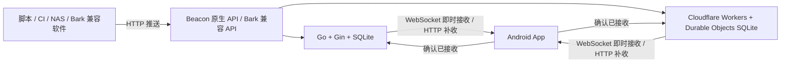

# Beacon

## 1. 这是什么

Beacon 是一个自托管的 Android 消息推送应用。手机安装 App，服务端部署在自己的服务器、NAS 或 Cloudflare Workers 上，脚本、CI 和其他软件就可以通过 HTTP API 向手机发送通知。

适合接收下载完成、任务执行结果、服务器告警等消息。支持 Beacon 原生 API 和 Bark 兼容推送接口，手机通过 WebSocket 即时接收或 HTTP 定时补收，不依赖第三方手机推送通道。

本项目包含 Android 客户端、Go 服务端和 Workers 服务端。“三端”指这三个组件；使用时安装 Android App，再任选一种服务端即可。

## 2. 主要功能

- **Android 自托管推送**：支持 WebSocket 即时接收、HTTP 定时补收，以及按电量、时间段、充电和 Wi-Fi 条件切换的规则接收。
- **两种服务端可选**：Go 单文件 / Docker 适合服务器和 NAS；Cloudflare Workers 使用 Durable Objects SQLite 保存数据。
- **Beacon 原生 API 与 Bark 兼容接口**：脚本可发送标题、副标题、Markdown 正文、优先级、分组和有效期；原生接口支持最多一个 HTTPS 操作按钮。
- **离线补收与接收确认**：消息先保存到服务端，手机恢复连接后补收有效消息；推送请求支持幂等键，避免重试产生重复消息。
- **手机内管理**：在 App 中绑定设备、管理应用令牌、发送测试消息、查看存储概况和清理数据。
- **通知与消息管理**：支持免打扰时段、过时消息提醒策略、锁屏预览、消息搜索与分组筛选、历史导入导出及设置备份。
- **MCP 接入**：本机 stdio 服务可供支持 MCP 的 AI 客户端发送任务通知，详见 [MCP 文档](mcp/README.md)。

即时接收需要允许 Android 后台运行，连接稳定性受系统和网络影响；定时补收可能延迟。服务端接收成功表示消息已保存，接收确认表示客户端已接收，均不代表用户已经阅读。

## 3. 技术架构



图中两种服务端是可选方案，不需要同时部署。

| 组件 | 技术 | 职责 |
| --- | --- | --- |
| Android 客户端（`android/`） | Kotlin、Jetpack Compose、OkHttp、WorkManager、SQLite | 设备绑定、消息接收与本地保存、通知展示、服务器管理 |
| Go 服务端（`server/`） | Go、Gin、SQLite、WebSocket | 可部署为单文件程序或 Docker 容器，持久化消息和设备信息 |
| Workers 服务端（`workers/`） | TypeScript、Cloudflare Workers、Durable Objects SQLite | 托管 HTTP API、消息存储、WebSocket 连接与定时维护 |

两种服务端共用 `/api/v1/*` 和 `/api/admin/*` 协议。推送先保存到服务端，再投递给手机；断线恢复后，App 可以补收尚未过期的消息。HTTP 推送成功只表示服务端已接受并保存消息，不代表手机已经展示通知。

凭据分为管理令牌、一次性绑定码、设备推送密钥和设备接收凭据。管理令牌用于管理服务器，App 使用独立 Android Keystore 加密保存登录凭据并长期保留，退出登录或服务器拒绝凭据时清除；绑定码用于连接手机；推送密钥用于发送消息；接收凭据由 App 保存并用于同步与确认接收。

## 4. 三端获取与部署

### 4.1 Android 客户端

1. 打开 [Releases](https://github.com/ZeroHomers0/beacon/releases)，下载通用包 `beacon-release.apk`。同时提供 `beacon-release-arm64-v8a.apk`（64 位 ARM）和 `beacon-release-armeabi-v7a.apk`（32 位 ARM）；不确定设备架构时选择通用包。
2. 在 Android 8.0 及以上设备安装，首次安装时按系统提示允许对应来源安装应用。
3. 安装后按第 5 节绑定自己的服务端，并开启通知权限。

若某次构建只有 `beacon-release-unsigned.apk`，该文件需要自行签名后才能安装。自行编译可使用 `android/` 中的 Gradle 工程；正式版本签名配置见 [构建脚本](android/app/build.gradle.kts)。

Android 流水线按 v7a、v8a、通用包三个并行任务构建，分别提供校验和，使用相同的版本号和正式签名。App 内更新继续下载通用包。自行编译时默认生成通用包，也可在 `android/` 下运行 `./gradlew -PbeaconAbi=arm64-v8a :app:assembleRelease` 或 `./gradlew -PbeaconAbi=armeabi-v7a :app:assembleRelease` 生成对应架构的包。

### 4.2 Go 服务端

#### Docker / NAS 部署

从 [Releases](https://github.com/ZeroHomers0/beacon/releases) 下载 `docker-compose.yaml`，放到单独目录中。也可以使用仓库中的 [Compose 配置](server/docker-compose.yaml)。以下命令适用于 Linux 服务器：

```bash
mkdir -p beacon-data
sudo chown 65532:65532 beacon-data
sudo chmod 700 beacon-data
openssl rand -hex 32
```

将生成的随机值填入配置中的 `BEACON_WEB_ADMIN_TOKEN`，替换示例令牌。然后启动：

```bash
docker compose up -d
docker compose ps
curl http://127.0.0.1:8088/healthz
```

默认镜像为 `ghcr.io/zerohomers0/beacon-server:latest`。数据保存在当前目录的 `beacon-data/`，容器以 UID/GID `65532:65532` 运行，目录必须提前创建并允许该用户写入；NAS 可通过其权限管理界面设置。

配置自己的 HTTPS 域名，例如 `https://push.example.com`，将反向代理上游指向 `http://127.0.0.1:8088`，并开启 WebSocket 转发（保留 `Upgrade` 和 `Connection` 请求头）。Compose 默认只监听宿主机回环地址；如果反向代理运行在其他容器或其他机器，需要相应调整网络与上游地址。

#### 单文件部署

从 [Releases](https://github.com/ZeroHomers0/beacon/releases) 下载符合服务器架构的 `beacon-server-linux-amd64` 或 `beacon-server-linux-arm64`。以 amd64 为例：

```bash
chmod +x beacon-server-linux-amd64
export BEACON_WEB_ADMIN_TOKEN="$(openssl rand -hex 32)"
./beacon-server-linux-amd64 -listen 127.0.0.1:8088 -db ./beacon.db
```

妥善保存生成的管理令牌，以便在 App 中登录服务器管理。正式运行可用 systemd 等方式托管进程，并配置 HTTPS 和 WebSocket 反向代理。数据库会自动初始化。

### 4.3 Cloudflare Workers 服务端

#### 可视化快速部署

1. 将 [Beacon 仓库](https://github.com/ZeroHomers0/beacon) Fork 到自己的 GitHub 账号。
2. 打开 [Cloudflare 控制台](https://dash.cloudflare.com/)，进入 **Workers & Pages**，创建 Worker，选择通过 GitHub 仓库导入，授权并选中自己的 Fork。
3. 设置根目录为 `workers`，Worker 名称与 `workers/wrangler.toml` 中的 `name` 保持一致，默认是 `beacon-server`。
4. 构建命令填写 `npm run build`，部署命令填写 `npm run deploy`，完成部署。构建依赖来自 `workers/package.json`；若构建环境未自动安装依赖，可将构建命令改为 `npm ci && npm run build`。根目录设置说明见 [Cloudflare 构建配置](https://developers.cloudflare.com/workers/ci-cd/builds/configuration/)。
5. 在该 Worker 的 **Settings → Variables and Secrets（设置 → 变量和机密）** 中添加运行时 **Secret**：名称为 `ADMIN_TOKEN`，值为自己生成并保存的随机令牌。建议使用 `openssl rand -hex 32` 生成的 64 位十六进制字符串。保存并部署使其生效。
6. 访问 `https://你的Worker域名/healthz`，确认返回 `status: ok`，再用该 HTTPS 服务地址在 App 中绑定。

`ADMIN_TOKEN` 必须是运行时机密，放在 Build variables 中无法供服务端使用。未配置或长度不足 32 字符时，服务端返回 `503 server_not_configured`。

本项目通过 [wrangler.toml](workers/wrangler.toml) 声明 `BEACON` Durable Objects 绑定和 SQLite 存储类，首次访问时自动初始化数据库，无需手工创建 D1、KV、R2 或上传 SQL。保留默认 `BEACON_INSTANCE=default`；修改它会指向另一个数据实例，因此绑定设备后应保持不变。

如果默认 `workers.dev` 域名在你的网络中无法访问，可在 Worker 的域名设置中添加自定义域名。SQLite Durable Objects 可用于 Workers 免费计划，具体额度和收费以 [Cloudflare 官方说明](https://developers.cloudflare.com/durable-objects/platform/pricing/) 为准。

#### CLI 部署

本机准备好 Git、Node.js 和 npm 后执行：

```bash
git clone https://github.com/ZeroHomers0/beacon.git
cd beacon/workers
npm ci
npx wrangler login
npm run check
npm run deploy
npx wrangler secret put ADMIN_TOKEN
```

最后一步按提示输入自己生成的管理令牌。部署完成后用 `/healthz` 检查服务，并保存服务地址与管理令牌。

## 5. 简单教程

### 绑定手机并发送第一条消息

1. 部署任意一种服务端，确认手机能够访问其 HTTPS 地址。
2. 打开 App 的「服务器管理」，输入服务地址和部署时设置的管理令牌。
3. 创建设备绑定码。管理接口生成的绑定码 **10 分钟内有效，仅可使用一次**。
4. 在「服务器配置」填写同一个服务地址、设备名称和绑定码，完成绑定；管理页面也提供绑定当前手机的操作。
5. 开启通知权限，在「接收模式」中选择「即时接收」。按系统提示允许后台运行，并调整电池优化设置。
6. 在连接设置中点击「复制推送密钥」，执行下面的推送命令，确认 App 中出现消息和系统通知。

```bash
curl -X POST 'https://push.example.com/api/v1/push' \
  -H 'Authorization: Bearer YOUR_PUSH_KEY' \
  -H 'Content-Type: application/json' \
  -d '{"title":"你好，Beacon","body":"第一条推送消息","priority":5}'
```

将 `https://push.example.com` 替换为自己的服务地址，`YOUR_PUSH_KEY` 替换为设备推送密钥。App 的连接设置也提供可直接复制的推送示例。

### 接收方式与省电设置

| 模式 | 行为 | 适用情况 |
| --- | --- | --- |
| 即时接收 | 保持 WebSocket 连接，断线重连后补收 | 需要及时接收通知 |
| 省电接收 | 使用 HTTP 周期补收，执行时间由 Android 后台调度决定 | 可以接受延迟；也是初始默认模式 |
| 规则接收 | 根据电量、时间段、充电或 Wi-Fi 条件切换 | 希望按使用环境调整接收方式 |

自适应心跳默认开启，使用 60、90、120、180、240、300 秒档位，每档连续确认 3 次后才继续上探；已有网络记录会先以 60 秒验证，再尝试记忆间隔。心跳超时后回退到较短的安全档位，并按网络记忆失败间隔，30 分钟内不再尝试该间隔及更长间隔。关闭后使用所选固定间隔。反向代理应允许至少 450 秒的 WebSocket 空闲连接。

「普通消息批量接收」默认关闭。开启后，优先级 0–7 的新消息等待下一次心跳集中投递，8–10 仍立即投递，每批最多 100 条。手动同步和重连补收可直接拉取消息；批量接收会增加普通消息的等待时间。

客户端会合并接收回执、减少正常连接下的重复 HTTP 补收，并在限流或服务故障时按 `Retry-After` 等待重试。未获电池优化豁免的设备进入系统休眠时会暂停长连接，退出休眠后恢复并补收；休眠期间的后台任务不保证即时执行。

### 通知、历史与应用令牌

- **通知设置**：按优先级选择通知渠道，可设置免打扰时段、过时消息静默或仅保存，以及锁屏内容预览。最终提醒效果受 Android 通知渠道与系统设置影响。
- **消息详情**：支持 Markdown 渲染、查看原文、复制与分享；正文图片默认不下载，提供点击加载入口。HTTPS 操作按钮由用户点击后打开。
- **搜索与筛选**：可按已读状态、分组或应用筛选，也可搜索标题、正文、分组、应用名称和 ID；支持 `group:CI`、`app:完整应用ID`。
- **存储与备份**：手机本地历史支持清理、导入导出，设置可单独备份；服务端历史保留时间独立配置。
- **应用令牌**：在「服务器管理」中为脚本创建独立令牌并设置默认优先级。令牌只在创建时显示一次，发送时使用 `Authorization: Bearer <应用令牌>`；复制的推送地址不含令牌。令牌可单独撤销；撤销后可删除应用及其消息和投递队列。

### MCP 接入

仓库的 `mcp/` 提供本机 stdio 服务，需要 Node.js 18 或以上。将 MCP 客户端的启动命令配置为 `node /绝对路径/beacon/mcp/beacon.mjs`，并传入 `BEACON_BASE_URL` 和 `BEACON_PUSH_KEY` 即可发送通知，无需单独部署网络服务。

工具包括 `push_notification`（推送）、`beacon_status`（只读能力查询）和 `beacon_apps`（只读管理概况）；后两项分别需要额外的设备接收凭据与管理令牌。完整配置、参数与验证方式见 [MCP README](mcp/README.md)。

### 定时任务示例

[examples/qinglong](examples/qinglong/README.md) 提供一个青龙面板脚本：定时拉取「60s API」的每日新闻，整理成 Markdown 推送到本服务。脚本只用 Python 标准库，按日期去重，并附带 `Idempotency-Key`，可直接照着改成其他数据源的定时推送。

## 6. 支持的 API

Go 和 Cloudflare Workers 两种服务端均支持以下接口。先在 App 中绑定服务器，再在连接设置中点击「复制推送密钥」。下面示例中的 `https://push.example.com` 替换为自己的服务地址，`YOUR_PUSH_KEY` 替换为设备推送密钥。推送密钥允许向对应设备发送消息，请勿公开；绑定码和管理令牌不能代替它。App 的连接设置也提供可直接复制的推送示例。

### Beacon 原生接口

向 `POST /api/v1/push` 发送 JSON，通过 `Authorization: Bearer <密钥>` 认证：

```bash
curl -X POST 'https://push.example.com/api/v1/push' \
  -H 'Authorization: Bearer YOUR_PUSH_KEY' \
  -H 'Content-Type: application/json' \
  -d '{"title":"下载完成","subtitle":"NAS","body":"文件已下载","priority":5}'
```

| 字段 | 说明 |
| --- | --- |
| `body` | 必填，非空正文，最多 65536 UTF-8 字节 |
| `title` | 可选，标题，最多 1024 UTF-8 字节 |
| `subtitle` | 可选，副标题，最多 1024 UTF-8 字节 |
| `priority` | 可选，0–10 的整数；设备推送密钥默认使用 5 |
| `actions` | 可选，最多 1 个操作按钮，格式为 `[{"title":"查看日志","url":"https://example.com/logs"}]`；省略或空数组表示没有按钮 |
| `group` | 可选，消息分组，最多 128 UTF-8 字节 |
| `ttl` | 可选，消息投递有效期，单位秒，0–604800 的整数；省略或 0 使用七天默认值 |

优先级 0–1 仅保存消息，2–3 静默通知，4–7 普通通知，8–10 重要通知。原生接口也接受服务端管理中创建的应用推送令牌；省略 `priority` 时使用该应用的默认优先级。

成功返回 HTTP 200，响应包含消息的 `id`、`sequence`、`expires_at_ms` 等信息。使用应用令牌发送时还包含 `application_id` 与 `application_name`；它们由服务器生成，不能由发送方指定。

正文可直接发送 Markdown，无需额外格式字段，原生 API 与 Bark 接口均适用。Android 客户端在详情页渲染标题、加粗、斜体、列表、引用、链接和代码块，并提供「查看原文」切换；通知与消息列表显示去除排版标记的短摘要。复制、分享和搜索仍使用原始正文。Markdown 中前五个不同的有效 HTTPS 图片地址提供点击加载入口，默认不下载图片；网页链接点击后确认打开。HTML 只显示为文本，暂不支持表格、公式等扩展语法。正文上限为 65536 UTF-8 字节。

#### 带操作按钮的消息

每个操作必须包含 `title` 和 `url`，不接受其他字段。`title` 不能全为空白或包含控制字符，输入最多 64 UTF-8 字节，展示文案最多四个字符，超出自动截断；`url` 最多 2048 UTF-8 字节，必须为有效 HTTPS 地址，不能包含用户名或密码。`actions: null`、超过 1 个按钮或无效字段返回 `400 invalid_message`。

```bash
curl -X POST 'https://push.example.com/api/v1/push' \
  -H 'Authorization: Bearer YOUR_PUSH_KEY' \
  -H 'Content-Type: application/json' \
  -d '{"title":"构建失败","body":"主分支构建失败，请查看日志","group":"CI","actions":[{"title":"查看日志","url":"https://ci.example.com/builds/123"}]}'
```

App 在消息详情展示按钮和目标地址，点击后交给系统浏览器或对应应用打开。收到消息不会自动打开链接，也不会代用户发起带鉴权的请求。按钮随历史消息和备份保存，HTTP 补收与即时接收均支持；幂等判断包含按钮标题、地址和排列顺序。

Bark 的 `url` 在详情页显示为“打开链接”按钮，Bark 接口不支持 `actions` 数组。

需要自动重试的脚本可添加 `Idempotency-Key` 请求头（1–128 个不含空格的可见 ASCII 字符）。同一发送凭据下，相同键与相同内容在首次成功后七天内返回原消息，不重复保存或创建投递任务；同键不同内容返回 `409 idempotency_conflict`。消息已确认、已过期或历史已清理时仍返回原结果，不重新投递。换用不同凭据、超过七天或不带幂等键时会创建新消息。每个业务事件使用一个新键，失败重试时保持键和内容一致。

```bash
curl -X POST 'https://push.example.com/api/v1/push' \
  -H 'Authorization: Bearer YOUR_PUSH_KEY' \
  -H 'Idempotency-Key: build-20261012-001' \
  -H 'Content-Type: application/json' \
  -d '{"title":"构建完成","body":"构建已通过","group":"CI","ttl":3600}'
```

有效期按服务端时间计算。到期后 HTTP 补收和 WebSocket 均停止投递，后台维护随后清理过期正文；已保存到手机的历史不会随有效期到期而消失。手机消息卡片显示分组与应用名称，点击标签可精确筛选，也可在搜索栏输入 `group:CI` 或 `app:完整应用ID`。普通搜索同时匹配正文、标题、分组、应用名称和应用 ID。

服务端接收成功表示消息已保存，不代表手机已经收到或展示通知。

### Bark 兼容接口

支持自定义服务器地址的 Bark 第三方软件，可以直接通过 Beacon 服务推送到自己的 App。如果软件要求填写完整的 Bark 推送链接，填：

```text
https://push.example.com/YOUR_PUSH_KEY
```

如果软件分别要求服务器地址和 Device Key，则分别填写 `https://push.example.com` 和设备推送密钥。Bark 接口使用设备推送密钥，应用推送令牌请使用上面的原生接口。只支持固定 Bark 官方地址、无法修改服务器的软件不能通过此方式接入。

支持以下 GET 路径，消息内容作为路径片段时需要 URL 编码，尤其是 `/`、`?`、`#` 等字符：

```text
GET /<密钥>/<正文>
GET /<密钥>/<标题>/<正文>
GET /<密钥>/<标题>/<副标题>/<正文>
```

也可以通过查询参数发送，使用 `curl --data-urlencode` 自动编码中文和特殊字符：

```bash
curl --get 'https://push.example.com/YOUR_PUSH_KEY' \
  --data-urlencode 'title=下载完成' \
  --data-urlencode 'body=文件已下载到 NAS'
```

支持 `POST /push`，请求体可以是 JSON 或 `application/x-www-form-urlencoded` 表单，用 `device_key` 指定设备：

```bash
curl -X POST 'https://push.example.com/push' \
  -H 'Content-Type: application/json' \
  -d '{"device_key":"YOUR_PUSH_KEY","title":"下载完成","body":"文件已下载到 NAS"}'
```

也支持向 `POST /<密钥>` 发送同样的 JSON 或表单，此时无需填写 `device_key`。参数优先级为路径 > 查询参数 > 请求体。成功响应示例：

```json
{"code":200,"message":"success","timestamp":1791763200,"id":"消息 ID","sequence":1}
```

兼容范围：

- 支持 `title`、`subtitle`、`body`，文本长度限制与原生接口一致。
- `level=passive` 或 `sound=none` 对应优先级 2；`level=timeSensitive`、`level=critical` 对应优先级 8；其余默认使用 5。Android 通知效果仍受系统通知权限和通知渠道设置影响。
- 接收 `image`、`icon`、`url`、`sound` 扩展字段；链接字段仅保留有效的 HTTPS 地址。Bark 的 iOS 铃声和 critical alert 权限不等同于 Android 上的效果。
- 接收 `ciphertext`、`iv` 加密字段，解密需要在接收端配置匹配的 Bark 加密密钥；服务端不接收 AES 密钥。
- 支持 `group` 与 `ttl`；Beacon 的 `ttl` 单位为秒，范围与原生接口一致，JSON 可使用整数或整数字符串，表单/查询参数使用整数字符串。
- Bark 接口也支持 `Idempotency-Key` 请求头，作用域、有效窗口与原生接口相同。
- `badge`、`action` 等未实现参数会被忽略，不影响正常文本推送。

### 常见错误

| HTTP 状态 | 含义 |
| --- | --- |
| `400` | 消息或参数格式不正确，例如正文为空、文本超长 |
| `401` | 推送密钥无效或已撤销 |
| `413` | 请求过大 |
| `415` | Bark POST 请求的 Content-Type 不受支持，请使用 JSON 或表单 |
| `409` | 幂等键已用于不同内容，请为新事件使用新键 |
| `429` | 推送频率超过限制，稍后重试 |
| `507` | 服务端存储容量达到限制 |


### 客户端与管理接口

以下接口在两种服务端中均支持。除绑定和健康检查外，认证均使用 `Authorization: Bearer <对应凭据>`；推送密钥不能代替接收凭据或管理令牌。

| 方法 | 路径 | 认证 | 用途 |
| --- | --- | --- | --- |
| GET | `/healthz` | 无 | 健康检查 |
| POST | `/api/v1/bind` | 一次性绑定码（请求体） | 绑定设备，字段为 `binding_code`、`device_name` |
| GET | `/api/v1/capabilities` | 设备接收凭据 | 查询服务端能力与协议 |
| GET | `/api/v1/realtime/config` | 设备接收凭据 | 获取即时连接配置 |
| GET / WebSocket Upgrade | `/api/v1/realtime/stream` | 设备接收凭据 | 建立即时接收连接 |
| GET | `/api/v1/messages` | 设备接收凭据 | 分页获取消息，支持 `after`、`limit`、`pending=1` |
| POST | `/api/v1/messages/ack` | 设备接收凭据 | 确认接收，请求体为 `{"ids":["消息 ID"]}` |
| POST | `/api/v1/receipts/status` | 设备接收凭据 | 查询消息回执，请求体为 `{"ids":["消息 ID"]}` |
| POST | `/api/v1/device/revoke` | 设备接收凭据 | 撤销当前设备 |
| GET | `/api/admin/overview` | 管理令牌 | 查询设备、应用和存储概况 |
| GET | `/api/admin/metrics` | 管理令牌 | 按路由模板聚合的请求量、5xx 数与延迟分桶（用于排查慢接口，不含路径参数与凭证） |
| POST | `/api/admin/binding` | 管理令牌 | 创建绑定码，字段为 `name` |
| POST | `/api/admin/test` | 管理令牌 | 向设备发送测试消息，字段为 `device_id`、`title`、`subtitle`、`body`、`priority` |
| POST | `/api/admin/revoke` | 管理令牌 | 撤销设备，字段为 `device_id` |
| POST | `/api/admin/devices/delete` | 管理令牌 | 删除设备及关联数据，字段为 `device_id` |
| POST | `/api/admin/messages/clear` | 管理令牌 | 清空服务端消息，请求体为 `{}` |
| POST | `/api/admin/applications` | 管理令牌 | 创建应用令牌，字段为 `device_id`、`name`、`default_priority` |
| POST | `/api/admin/applications/revoke` | 管理令牌 | 撤销应用令牌，字段为 `id` |
| POST | `/api/admin/applications/delete` | 管理令牌 | 删除已撤销的应用令牌及其消息，字段为 `id` |

例如，不通过 App 管理页面也可以创建绑定码：

```bash
curl -X POST 'https://push.example.com/api/admin/binding' \
  -H 'Authorization: Bearer YOUR_ADMIN_TOKEN' \
  -H 'Content-Type: application/json' \
  -d '{"name":"我的手机"}'
```

Go 服务端需要设置 `BEACON_WEB_ADMIN_TOKEN` 才会启用管理接口，要求为 64 位十六进制字符串，也可通过 `BEACON_WEB_ADMIN_TOKEN_FILE` 从文件读取；Workers 必须设置至少 32 字符的 `ADMIN_TOKEN` 才能正常提供服务。

## 7. 常见问题

### 必须同时部署 Go 和 Workers 吗？

任选一个即可。已有服务器或 NAS 可以使用 Go / Docker；希望托管在 Cloudflare 上可以使用 Workers。更换服务端需要在 App 中重新绑定，两种后端的数据独立保存。

### 打开服务地址为什么没有网页？

当前服务端提供 API，没有浏览器管理首页。请访问 `/healthz` 检查服务，在 Android App 的「服务器管理」中管理设备和应用。

### Workers 返回 `server_not_configured` 怎么办？

检查当前 Worker 是否配置了运行时 Secret `ADMIN_TOKEN`，长度至少 32 字符，并已部署生效。Build variables 不属于运行时机密。也需保留 `BEACON_INSTANCE` 配置。

### Cloudflare 看不到 Fork 仓库怎么办？

检查 Cloudflare 的 GitHub 应用是否获准访问该仓库，重新授权或刷新仓库列表，并确认所选 GitHub 账号正确。构建找不到 `package.json` 或 `wrangler.toml` 时，检查根目录是否设为 `workers`。

### API 返回成功，手机为什么没通知？

先查看 App 中是否已经出现消息。有消息但无通知时，检查通知权限、通知渠道、免打扰和消息优先级；没有消息时，检查服务器连接、接收模式、规则条件和后台运行权限。即时接收还需要反向代理正确转发 WebSocket。省电模式可能被 Android 延后执行，可以手动同步检查。

### 管理令牌、绑定码和推送密钥有什么区别？

管理令牌可以管理整个实例；绑定码仅用于一次设备绑定；推送密钥仅用于向对应设备发送消息。它们不能互换。应用推送令牌使用 Beacon 原生接口，Bark 接口使用设备推送密钥。

### Bark 软件能直接接入吗？

可以，前提是软件允许修改 Bark 服务器地址或填写完整推送链接。填写自己的服务地址与设备推送密钥，消息由 Beacon Android App 接收。兼容参数范围见第 6 节。

### 消息保存多久？

未确认接收的消息投递窗口为 7 天，回执窗口为 30 天。已确认消息的服务端历史默认保留 1 天，可用 Go 的 `BEACON_HISTORY_RETENTION_DAYS` 或 Workers 的 `HISTORY_RETENTION_DAYS` 调整，实际范围为 1–30 天，`0` 按 1 天处理。手机本地消息由 App 的存储与清理设置管理。

Go 服务端在写入前校验 UTF-8 和消息字节长度，超限拒绝，不截断正文。单设备待收消息最多 10000 条、64 MB，全局消息最多 100000 条、有效数据库页预算 256 MB；满额时拒绝新推送，不删除仍在有效期内的待收消息。SQLite 主文件另设 512 MB 页数上限（已有更大文件不会自动缩小），删除后的空闲页复用；WAL 每 256 页自动检查点，检查点完成后的日志保留目标为 4 MB，该值不是活跃事务期间的硬上限。不要长期持有外部 SQLite 读事务，以免妨碍检查点回收。

绑定码最多保留 1000 条，过期绑定码随每分钟的分批维护自动删除。Compose 使用 Docker `local` 日志驱动，单文件 10 MB、最多 3 个文件；更新现有部署需重新创建容器以应用日志配置。直接运行二进制时由 systemd/journald 或外部日志轮转工具限制标准输出日志；反向代理日志也需独立设置轮转，且不得记录带凭证的 Bark URL。Workers 的存储与日志由 Cloudflare 管理，不适用 Docker/SQLite 文件配置。

Go、Workers 与 Android 的消息字段限制一致：标题和副标题各 1024 UTF-8 字节，非空正文 65536 字节，名称和分组各 128 字节，Bark 元数据 100000 字节，自定义按钮最多 1 个（按钮标题输入上限 64 字节、显示前 4 个字符，HTTPS URL 上限 2048 字节）。非法 Unicode 拒绝接收，HTTP 与 WebSocket 消息及历史导入共用客户端字段校验。管理端发送前检查名称、标题、正文和 512 KB 请求上限；服务端仍独立验证，不依赖客户端可信。

Go 与 Workers 均限制设备最多 1024 个、应用最多 4096 个，包含已撤销但尚未删除的记录。Workers 正常维护间隔为 1 分钟，每张过期表每批最多 100 条，有积压时 1 秒后继续，覆盖消息、回执、幂等记录、绑定码和限流记录。Android 保留现有有界同步分页、32 MB 加密历史导入、2 MB 单图片下载及 6 MB/12 张图片缓存限制；手机本地历史按用户清理规则保留，不照搬服务端保留时间自动删除。

### 可以使用 HTTP 地址吗？

正式版 App 使用 HTTPS 服务地址。仅部署 Go HTTP 监听端口还不够，需要在前面配置 HTTPS 反向代理；Workers 可使用部署后提供的 HTTPS 地址。

### 推送密钥泄露或遇到其他问题怎么办？

撤销受影响的设备并创建新绑定码，在 App 中重新绑定；也可单独撤销泄露的应用令牌，再更新脚本中的密钥。反馈问题请到 [GitHub Issues](https://github.com/ZeroHomers0/beacon/issues)，附上版本、部署方式、复现步骤和错误提示。不要公开管理令牌、绑定码、推送密钥或私人消息内容；反向代理访问日志也应避免记录带密钥和正文的 Bark URL。

## 开源许可与第三方致谢

Beacon 项目本身以 [MIT License](LICENSE) 发布。

第三方组件及图标的许可说明统一在此查阅，App 的“使用与部署文档”入口可打开本 README。

| 组件或资源 | 版权归属 | 许可 |
| --- | --- | --- |
| OkHttp、Okio | Square, Inc. | Apache-2.0 |
| Material Symbols Rounded | Google LLC | Apache-2.0 |
| MIUIX | compose-miuix-ui contributors | Apache-2.0 |
| Markwon core | Markwon contributors | Apache-2.0 |
| commonmark-java | Atlassian Pty Ltd | BSD-2-Clause |

完整归属信息见 [第三方 NOTICE](android/app/src/main/assets/third-party/NOTICE.txt)，许可全文见 [Apache-2.0](android/app/src/main/assets/third-party/Apache-2.0.txt) 和 [BSD-2-Clause](android/app/src/main/assets/third-party/commonmark-BSD-2-Clause.txt)。这些声明与许可文件仍随 APK 分发。上述第三方许可与 [MIT License](LICENSE)（Beacon 项目自身）互相独立，各覆盖各自的部分。
